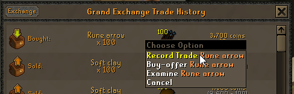
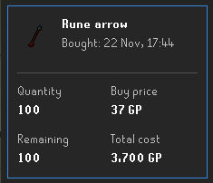
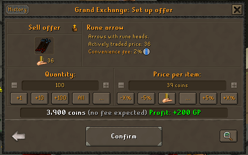
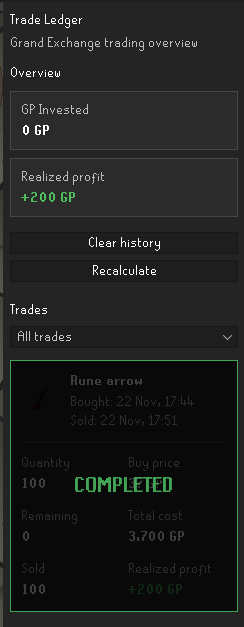
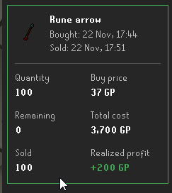

# Trade Ledger

**Trade Ledger** is a RuneLite plugin for Old School RuneScape that helps players track Grand Exchange transactions, manage purchased inventory, and monitor flipping profits.

Record your purchases, follow your sales, and see how much profit you're making without relying on external spreadsheets or manually calculating Grand Exchange taxes.

## Features

### Grand Exchange Transaction Tracking

- Record purchases directly from Grand Exchange history using the **Record Trade** right-click option.





- Record sales from Grand Exchange history.
- Automatically detect sales through Grand Exchange offer updates.
- Track purchased quantities, remaining inventory, and realized profits.
- Support partial sales and multiple purchases of the same item.
- Match automatic sales to recorded purchases using First In, First Out (FIFO) accounting.
- Automatically mark purchase records as completed when all items have been sold.

### Live Profit Estimates



Trade Ledger displays estimated profit or loss directly in the Grand Exchange interface when configuring a sell offer.

- Calculates estimated profit using recorded purchase costs.
- Accounts for estimated Grand Exchange tax.
- Updates estimates as offer quantities and prices change.
- Displays profitable trades in green and losses in red.
- Supports configurable single-line and multiline profit displays.

Profit estimates are only available when sufficient recorded inventory exists for the selected item.

### Transaction Dashboard





View and manage recorded transactions from a dedicated RuneLite sidebar.

Each purchase card displays:

- Item name and icon
- Purchase date
- Purchased quantity
- Purchase price
- Total purchase cost
- Remaining quantity
- Sold quantity and realized profit, when applicable
- Transaction status

Cards use distinct visual states for open, completed, and canceled transactions.

### Overview Statistics

The Overview provides a summary of your recorded trading activity, including:

- **GP Invested:** Purchase cost attributable to remaining unsold inventory.
- **Realized Profit:** Profit or loss from recorded sales.
- **Items Remaining:** Quantity of purchased items not yet sold.
- **Trade Status:** Summary of open and completed trades.

Each Overview statistic can be independently shown or hidden through the plugin configuration.

### Transaction Management

- Filter and browse recorded transactions.
- Add or edit transaction notes.
- View transaction details.
- Cancel and restore recorded trades.
- Remove unwanted transaction records.
- Preserve recorded transactions between RuneLite sessions.

## Installation

1. Open RuneLite.
2. Open the **Configuration** sidebar.
3. Select **Plugin Hub**.
4. Search for **Trade Ledger**.
5. Click **Install**.

Trade Ledger will appear in the RuneLite sidebar.

## How to Use

### Recording a Purchase

1. Buy an item through the Grand Exchange.
2. Open your Grand Exchange history.
3. Right-click the completed purchase.
4. Select **Record Trade**.

A new purchase card will appear in Trade Ledger.

Each recorded purchase is maintained separately, even when purchasing the same item multiple times at different prices.

### Tracking Sales

When items are sold through the Grand Exchange, Trade Ledger monitors offer updates and matches newly sold quantities against recorded purchases.

For multiple purchases of the same item, the oldest recorded purchase is matched first (FIFO).

Partial sales update the remaining quantity and realized profit. Once a purchase is fully sold, its card is automatically marked as completed.

### Viewing Expected Profit

1. Record a purchase in Trade Ledger.
2. Open a Grand Exchange sell offer for the same item.
3. Set the desired quantity and selling price.
4. View the estimated profit or loss alongside the Grand Exchange total.

The displayed estimate accounts for the recorded purchase cost and estimated Grand Exchange tax.

## Configuration

Trade Ledger includes settings for:

- Showing or hiding individual Overview statistics.
- Switching between single-line and multiline GE profit displays.

Settings are available through RuneLite's plugin configuration panel.

## Important Notes and Limitations

- **Manual sale records:** Sales manually recorded from GE history are stored separately and are not automatically matched to purchase cards.
- **Automatic sale detection:** Sales are tracked from observed Grand Exchange offer updates. Activity that cannot be observed or reconstructed by the plugin may not be reflected automatically.
- **Grand Exchange tax:** Automatic sale profit calculations use estimated tax rather than independently verified exact tax amounts.
- **Purchase tracking:** Purchases must currently be recorded manually from GE history.
- **Accounting:** Multiple purchases remain separate records. Automatic sales are matched using FIFO rather than averaging purchase prices.
- **Profit estimates:** Displayed estimates are informational and do not guarantee the final profit of a trade.

Trade Ledger does not automatically place, modify, or cancel Grand Exchange offers.

## Data Storage and Privacy

Trade Ledger stores transaction records locally using RuneLite's configuration storage.

The plugin does not require an external account, website, or remote trading service.

## Development

Trade Ledger is written in Java using the RuneLite Plugin API.

### Building from Source

Clone the repository:

```bash
git clone https://github.com/ThatGuyHatty/trade-ledger.git
cd trade-ledger
```

Build using the included Gradle wrapper:

**Windows**

```powershell
.\gradlew.bat clean build
```

**Linux / macOS**

```bash
./gradlew clean build
```

### Requirements

- Java development environment compatible with the project's RuneLite and Gradle versions
- Gradle wrapper included in the repository
- RuneLite development dependencies

## Disclaimer

Trade Ledger is an unofficial third-party RuneLite plugin and is not affiliated with, endorsed by, or sponsored by Jagex Ltd.

Old School RuneScape and RuneScape are trademarks of Jagex Ltd.